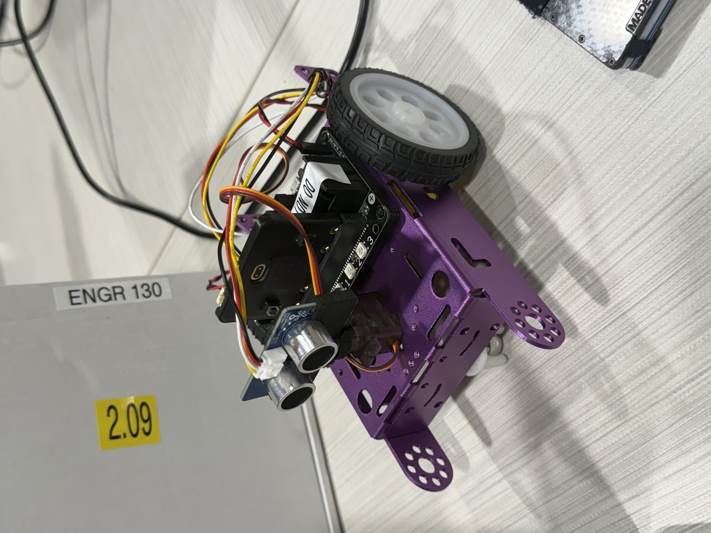

    Micro:bit Autonomous Pathfinding & Grid Navigation Robot

An autonomous differential-drive robot powered by a **BBC micro:bit** and a **KittenBot Robotbit** expansion board. 

The robot dynamically navigates a grid-based maze environment using breadth-first search (BFS) pathfinding, sweeping ultrasonic sensor scans, real-time map updates, and LED display feedback.

    Hardware Architecture

* **Controller:** BBC micro:bit

* **Motor Driver Board:** KittenBot Robotbit Board (PCA9685 PWM driver over I2C)

* **Motors:** Dual DC Gear Motors (Left & Right drive)

* **Sensor Mount:** Servo Motor (S1 channel) for sweeping scans

* **Distance Sensor:** Ultrasonic sensor for mapping and updating grid